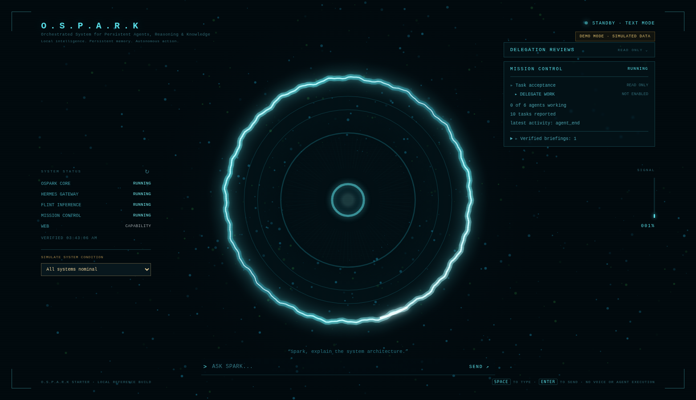

# OSPARK Starter

**A portable, local-first reference implementation for an agentic operating interface.**

*A practical companion project for the upcoming OSPARK architecture article.*

  



OSPARK Starter recreates the **concepts** behind the OSPARK interface as a **new, standalone project**: an animated orbital interface, a truthful system-health rail, read-only operational summaries, synthetic delegation-review evidence, and optional connections to compatible local AI services.

It is **not** a publication or an export of the private OSPARK system. It contains no private runtime, agent code, credential store, personal data, task database, model weights, or real approval/dispatch engine. The visual rendering is original Canvas2D, not the private app's shader or React implementation.

## Quickstart (no dependencies)

**Requires Node.js 20.10+**. Works on macOS, Linux, and Windows with a modern browser.

```bash
git clone https://github.com/YOUR-ACCOUNT/ospark-starter.git
cd ospark-starter
npm start
```

Open **http://127.0.0.1:4173**. No `npm install` or API key is necessary. Before publishing the project, replace the placeholder repository URL above with your actual public URL.

For a downloaded ZIP, unzip it, enter the `ospark-starter` directory and run `npm start`.

Demo mode uses explicitly **simulated** health and delegation data. Choose a scenario to see how the interface handles healthy, degraded, and unavailable services. The chat demonstration uses deterministic, canned replies and is **not** a language model.

### Try the health scenarios

The **SIMULATE SYSTEM CONDITION** selector supports:

- All systems nominal
- Mission Control degraded, including an example failed Kanban source
- Flint unavailable
- All dependencies unavailable

The left rail refreshes every 30 seconds, displays when it was last checked, and marks overdue readings as stale. The Mission Control section exposes failed sources without fabricating successful results.

## Connected mode (optional)

1. Copy `.env.example` to `.env` and set **only** the loopback URLs for services you run locally.
2. Start the service with `npm run connected`.
3. Unconfigured dependencies show `UNCONFIGURED`, never `RUNNING`.

Example (replace ports with your actual local services):

```dotenv
HERMES_BASE_URL=http://127.0.0.1:8642
FLINT_BASE_URL=http://127.0.0.1:8081
MISSION_CONTROL_BASE_URL=http://127.0.0.1:19465
```

The adapter probes fixed, read-only HTTP endpoints. See [local setup](docs/local-setup.md) for the expected API shapes. In connected mode, the starter exposes **aggregate status only**, not agent task titles, review reports, private prompt history, or credentials.

### Optional local-model chat

**Disabled by default.** If you want to speak with a plain, local, OpenAI-compatible inference server **without tools**, configure:

```dotenv
ALLOW_LOCAL_CHAT=1
MODEL_BASE_URL=http://127.0.0.1:8081
MODEL_ID=your-local-model-id
```

Do **not** point the chat adapter at an autonomous agent gateway, executor or server-side tool agent. `tool_choice: none` is requested by this starter but cannot guarantee that a third-party server won't execute hidden server-side tools. This feature is for simple tool-free inference only. No cloud voice, microphone, wake-word detection, or agent actions are bundled.

## Architecture

```text
                 Browser (127.0.0.1:4173)
              ┌───────────────────────────┐
              │ Canvas2D Spark-style UI    │
              │ System status / transcript │
              │ Synthetic review viewer    │
              └─────────────┬─────────────┘
                            │ same-origin HTTP
              ┌─────────────▼─────────────┐
              │ Node local adapter         │
              │ localhost only / no writes │
              └─────────────┬─────────────┘
                            │ bounded GET checks
          ┌─────────────────┼─────────────────┐
     Gateway /health    Inference /models   Mission Control /api/v1
       (optional)         (optional)        (optional)

     Optional, explicit tool-free model chat on /v1/chat/completions
```

The app uses **no runtime npm dependencies**. This is intentional: the starter is a learning and demonstration artifact designed to run without the original React/Vite application, MLX engine, privileged controller/worker, or a specific Mac.

Read [architecture](docs/architecture.md), [security model](docs/security-model.md), and [public release checklist](docs/public-release-checklist.md) before putting it online.

## Commands

| Command | Purpose |
|---|---|
| `npm start` | Demo mode, no dependencies |
| `npm run connected` | Read-only health checks against your configured local services |
| `npm test` | Node built-in tests |
| `npm run check` | Syntax-check JavaScript modules |

The server binds to **127.0.0.1 only**. This is a local starter, not a multi-user, internet-facing application.

## What's included / excluded

| Included | Not included |
|---|---|
| Original lightweight orbital visual | Private OSPARK source code or assets |
| Read-only gateway and service-health adapter | Agent execution or permission escalation |
| Simulated delegation review with conspicuous labels | Real owner acceptance, worker identities, orchestration |
| Source-level degradation diagnostics | Private database content |
| Optional tool-free inference chat | Automatic tool execution or approval bypass |
| Startup and refresh mechanisms | Voice models, speech recognition, cloud accounts |

## Status and roadmap

- **v0.1.0:** Standalone reproducible local reference app.
- **Next:** Documented adapter interfaces and community-contributed backend integrations.
- **Not promised:** A general-purpose secure agent execution framework. Such a system requires independent threat modeling, authorization controls, persistence design and hardening.

## Credits and license

MIT, see [LICENSE](LICENSE). See [NOTICE](NOTICE.md) for prior-art and attribution notes. All included source was authored for this public starter; no private OSPARK repository history or original JARVIS source is bundled. Respect upstream licenses if you later incorporate third-party code.

**Author note:** Replace `YOUR-ACCOUNT`, project maintainer details and legal notices with accurate information before publishing. This starter is a working reference implementation, not an audited security product.
